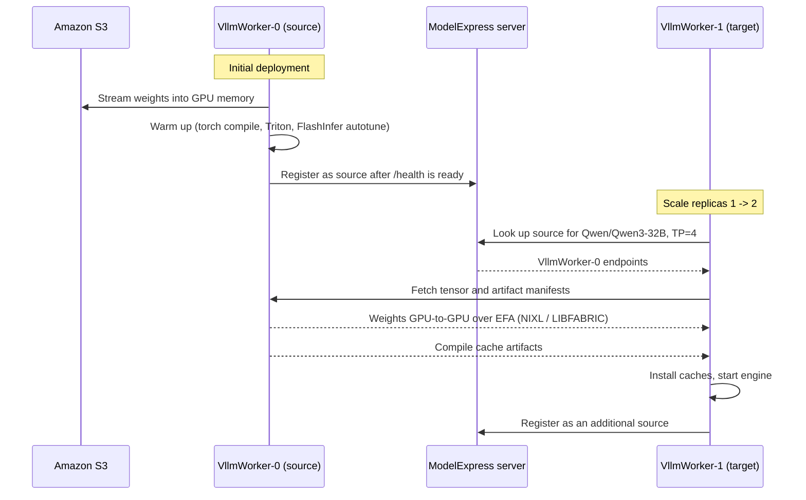

# Qwen3-32B Recipe

Model: [Qwen/Qwen3-32B](https://huggingface.co/Qwen/Qwen3-32B)

> **Note:** Run all commands in this recipe from the recipe folder (`blueprints/inference/nvidia-dynamo/recipes/qwen3-32b`). Manifest paths below are relative to that directory. If you are coming from the main setup guide, switch into it first:
>
> ```bash
> cd recipes/qwen3-32b
> ```

## Sync model weights

This recipe supports both weight sources from the [model-cache](../../model-cache/README.md) guide. Sync to the one that matches the manifest you plan to deploy, or both if you want to try all three:

| Weight source | Used by |
| --- | --- |
| [Amazon S3 bucket](#sync-to-amazon-s3) (recommended) | `vllm/h100-agg-mx-s3.yaml` |
| [`model-cache` PVC](#sync-to-the-model-cache-pvc) | `vllm/h100-agg.yaml`, `vllm/h100-disagg.yaml` |

### Sync to Amazon S3

When running the [HuggingFace-to-S3](../../model-cache/README.md#sync-model-weights-from-huggingface-to-amazon-s3) sync job, use the following values in the `s3ModelCopy` configuration. These are tuned for the size of Qwen3-32B:

| Parameter | Recommended value | Why |
| --- | --- | --- |
| `storageSize` | `100` | Scratch volume in GiB for the download. 100 GiB comfortably holds the full Qwen3-32B weights. |
| `requireNetworkBandwidth` | `25000` | Schedules the Job onto a node with at least 25 Gbps of network bandwidth, so the HuggingFace-to-S3 transfer isn't network-bound. |
| `parameters.fileWorkers` | `18` | Downloads up to 18 files in parallel to maximize throughput. There are 18 safetensors files with a max size of ~4GB each, so `storageSize` must scale accordingly - see the [sizing note](../../model-cache/README.md#sync-model-weights-from-huggingface-to-amazon-s3) in the model-cache guide. |

```bash
export MODEL_NAME="Qwen/Qwen3-32B"
helm -n dynamo-system install hf-s3-sync-model ai-on-eks/inference-charts -f - <<EOF
s3ModelCopy:
  namespace: dynamo-system
  model: $MODEL_NAME
  s3Bucket: $S3_BUCKET
  hfTokenSecret:
    name: "hf-token-secret"
    envFrom: true
  serviceAccountName: $MODEL_SYNC_SA
  requireLocalNvme: true
  storageSize: 100
  requireNetworkBandwidth: 25000
  parameters:
    fileWorkers: 18
EOF
```

> Total time: 54s

Once the Job completes, remove the release:

```bash
helm -n dynamo-system uninstall hf-s3-sync-model
```

### Sync to the model-cache PVC

The PVC manifests mount the `model-cache` PVC at `/models` and set `HF_HOME=/models` with `HF_HUB_OFFLINE=1`, so vLLM reads Qwen3-32B from the HuggingFace cache layout on the PVC and never calls HuggingFace at runtime. The Frontend mounts the same PVC to load the tokenizer.

Confirm the PVC exists:

```bash
kubectl -n dynamo-system get pvc model-cache
```

Run the [model download Job](../../model-cache/README.md#sync-model-weights-from-huggingface-to-pvc), which runs `hf download` into the PVC:

```bash
export MODEL_NAME="Qwen/Qwen3-32B"
envsubst '${MODEL_NAME}' < ../../model-cache/model-download.yaml | kubectl apply -n dynamo-system -f -

# Wait for the Pod to start (the scheduler may need to provision a node first)
kubectl -n dynamo-system wait --for=condition=ready pod --selector=job-name=model-download --timeout=600s

# Follow download progress
kubectl -n dynamo-system logs -l app=model-download -f
```

Confirm the Job succeeded, then delete it. The weights stay on the PVC:

```bash
kubectl -n dynamo-system get job/model-download
kubectl -n dynamo-system delete job/model-download
```

## Deploy Model - vLLM

The recipe ships three vLLM manifests. All of them run TP=4 on a `p5.48xlarge` (H100) with a 128K context window (YaRN rope scaling):

| Manifest | Weights from | Topology | Graph name |
| --- | --- | --- | --- |
| [`vllm/h100-agg-mx-s3.yaml`](vllm/h100-agg-mx-s3.yaml) | Amazon S3 through ModelExpress | Aggregated | `qwen3-32b-h100-agg-mx-s3-vllm` |
| [`vllm/h100-agg.yaml`](vllm/h100-agg.yaml) | `model-cache` PVC | Aggregated | `qwen3-32b-h100-agg-vllm` |
| [`vllm/h100-disagg.yaml`](vllm/h100-disagg.yaml) | `model-cache` PVC | Disaggregated prefill/decode | `qwen3-32b-h100-disagg-vllm` |

The S3 + ModelExpress manifest is the recommended path. The two PVC manifests need the weights [synced to the `model-cache` PVC](#sync-to-the-model-cache-pvc) first.

### Aggregated with ModelExpress (S3)

```bash
envsubst '${S3_BUCKET} ${INFERENCE_SA}' < vllm/h100-agg-mx-s3.yaml | kubectl apply -n dynamo-system -f -

# Watch all logs
kubectl -n dynamo-system logs -l nvidia.com/dynamo-graph-deployment-name=qwen3-32b-h100-agg-mx-s3-vllm --all-containers=true --max-log-requests=20 --prefix=true --timestamps -f
```

The deployment starts three components:

| Component | Role |
| --- | --- |
| `Frontend` | OpenAI-compatible HTTP endpoint with KV-aware routing across workers. |
| `ModelExpress` | ModelExpress server. Tracks which workers hold the loaded model so new workers can find a source to copy from. Uses Kubernetes as its metadata backend, so no Redis is needed. |
| `VllmWorker` | vLLM engine with TP=4 on one `p5.48xlarge`, loading weights with `--load-format modelexpress`. |

Since this is the first worker, no other worker is serving Qwen3-32B yet. It does a cold start:

1. Streams the weights from `s3://${S3_BUCKET}/Qwen/Qwen3-32B` straight into GPU memory.
2. Runs the full vLLM warm-up (torch compile, Triton kernels, FlashInfer autotuning), which fills the compile caches in their default locations in the container.
3. Waits until its health endpoint (`MX_ARTIFACT_READY_URL`, `:9090/health`) reports ready. Then it registers with the ModelExpress server as a **source**, publishing its weight metadata and, because `MX_ARTIFACT_TRANSFER=1`, its compile cache artifacts.

The source registers only after it's healthy, so other workers never copy weights from a worker that's still warming up.

### Aggregated (PVC)

```bash
kubectl apply -n dynamo-system -f vllm/h100-agg.yaml

# Watch all logs
kubectl -n dynamo-system logs -l nvidia.com/dynamo-graph-deployment-name=qwen3-32b-h100-agg-vllm --all-containers=true --max-log-requests=20 --prefix=true --timestamps -f
```

### Disaggregated prefill/decode (PVC)

Runs a `PrefillWorker` and a `DecodeWorker`, each on its own `p5.48xlarge` with TP=4. The KV cache moves from prefill to decode through NIXL over EFA (`LIBFABRIC` backend). Both workers must land in the same zone, so their `podAffinity` is required.

```bash
kubectl apply -n dynamo-system -f vllm/h100-disagg.yaml

# Watch all logs
kubectl -n dynamo-system logs -l nvidia.com/dynamo-graph-deployment-name=qwen3-32b-h100-disagg-vllm --all-containers=true --max-log-requests=20 --prefix=true --timestamps -f
```

## Smoke test

The steps are the same for every manifest. Set `GRAPH` to the graph name of the one you deployed:

```bash
export GRAPH=qwen3-32b-h100-agg-mx-s3-vllm   # or qwen3-32b-h100-agg-vllm / qwen3-32b-h100-disagg-vllm
```

Wait for the workers to become ready, then port-forward the frontend service to your machine:

```bash
kubectl -n dynamo-system wait pod \
  -l nvidia.com/dynamo-graph-deployment-name=${GRAPH} \
  --for=condition=Ready --timeout=30m

kubectl -n dynamo-system port-forward svc/${GRAPH}-frontend 8000:8000
```

In a second terminal, confirm the model is registered and send a chat completion request:

```bash
curl -s localhost:8000/v1/models | jq

curl -s localhost:8000/v1/chat/completions \
  -H "Content-Type: application/json" \
  -d '{
    "model": "Qwen/Qwen3-32B",
    "messages": [
      {"role": "user", "content": "Explain what Kubernetes is in two sentences."}
    ],
    "max_tokens": 1024,
    "stream": false
  }' | jq
```

A successful response returns a `choices[0].message.content` field with the model's answer. Qwen3 thinks by default, and these manifests don't set a reasoning parser, so the `<think>` block shows up inside `content`. Stop the port-forward with `Ctrl+C` when you're done.

## Scale replicas - ModelExpress P2P weight transfer

This section applies to the `h100-agg-mx-s3.yaml` deployment only.

When you add a second worker, it doesn't download Qwen3-32B from S3 again or redo the warm-up. It finds the running worker through the ModelExpress server and copies the weights GPU to GPU over EFA, using NIXL with the `LIBFABRIC` backend (`MX_NIXL_BACKEND`). It also pulls the source's compile caches, so it skips most of the torch compile and autotuning work.



A few manifest settings make this work:

- **Same zone.** The `VllmWorker` has a required `podAffinity` on `topology.kubernetes.io/zone`, so the new worker lands in the source's zone and the RDMA transfer stays on the EFA fabric.
- **Matching ranks.** A target only pairs with a source that has the same model and parallel layout (TP=4 here), and each GPU rank copies from the matching rank on the source.
- **Artifact transfer.** `MX_ARTIFACT_TRANSFER=1` turns on compile cache transfer. No cache paths need to be set: ModelExpress reads and installs the torch compile, Triton, and FlashInfer caches at vLLM's default locations, so those paths only need to be writable in the container.

Scale `VllmWorker` from 1 to 2 replicas. `VllmWorker` is the third entry in `spec.components` (index `2`). The `test` op makes the patch fail if that index ever points to a different component:

```bash
kubectl patch dynamographdeployment qwen3-32b-h100-agg-mx-s3-vllm \
  -n dynamo-system \
  --type='json' \
  -p='[
    {"op": "test", "path": "/spec/components/2/name", "value": "VllmWorker"},
    {"op": "replace", "path": "/spec/components/2/replicas", "value": 2}
  ]'
```

Watch both workers side by side. Pod index `0` is the original worker (source), and pod index `1` is the new one (target):

```bash
# Source: the original worker, loaded from S3
kubectl -n dynamo-system logs -l nvidia.com/dynamo-graph-deployment-name=qwen3-32b-h100-agg-mx-s3-vllm,nvidia.com/dynamo-component=VllmWorker,grove.io/podclique-pod-index=0 --all-containers=true --max-log-requests=20 --prefix=true --timestamps -f

# Target: the new worker, receiving weights over RDMA
kubectl -n dynamo-system logs -l nvidia.com/dynamo-graph-deployment-name=qwen3-32b-h100-agg-mx-s3-vllm,nvidia.com/dynamo-component=VllmWorker,grove.io/podclique-pod-index=1 --all-containers=true --max-log-requests=20 --prefix=true --timestamps -f
```

In the target's logs, the S3 streaming step is replaced by a NIXL transfer from the source, and the compile cache is installed before engine start-up. Compare how long the `main` container takes from start to Ready on each pod. This leaves out scheduling, node provisioning, and image pull, so you compare only model loading and engine warm-up:

```bash
kubectl -n dynamo-system get pods \
  -l nvidia.com/dynamo-graph-deployment-name=qwen3-32b-h100-agg-mx-s3-vllm,nvidia.com/dynamo-component=VllmWorker \
  -o json | jq -r '
    ["POD", "MAIN_STARTED", "MAIN_READY", "ELAPSED"],
    (.items[]
      | (.status.containerStatuses[] | select(.name == "main") | .state.running.startedAt) as $start
      | (.status.conditions[] | select(.type == "ContainersReady") | .lastTransitionTime) as $ready
      | [.metadata.name, $start, $ready, "\(($ready | fromdateiso8601) - ($start | fromdateiso8601))s"])
    | @tsv' | column -t
```

Once both workers are Ready, the Frontend routes requests across them with KV-aware routing, so you can re-run the [smoke test](#smoke-test) without changing anything. Scaling to 3 or more replicas works the same way, and every Ready worker is another source new targets can copy from.

## Cleanup

```bash
# Aggregated with ModelExpress (S3)
envsubst '${S3_BUCKET} ${INFERENCE_SA}' < vllm/h100-agg-mx-s3.yaml | kubectl delete -n dynamo-system -f -

# Aggregated (PVC)
kubectl delete -n dynamo-system -f vllm/h100-agg.yaml

# Disaggregated prefill/decode (PVC)
kubectl delete -n dynamo-system -f vllm/h100-disagg.yaml
```
