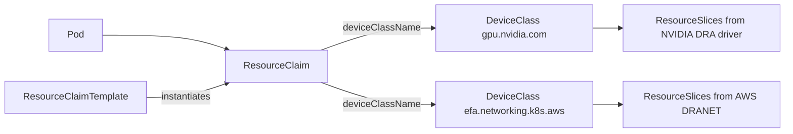

# Dynamic Resource Allocation (DRA) on EKS

[Dynamic Resource Allocation](https://kubernetes.io/docs/concepts/scheduling-eviction/dynamic-resource-allocation/) (DRA) is the Kubernetes API for requesting devices such as GPUs and network adapters. Instead of asking for an opaque count (`nvidia.com/gpu: 1`), a Pod references a `ResourceClaim` that describes the devices it needs, filters them with [CEL](https://kubernetes.io/docs/reference/using-api/cel/) expressions, and constrains how they relate to each other on the host. \
This blueprint provisions an Amazon EKS cluster with DRA drivers for NVIDIA GPUs and Elastic Fabric Adapter (EFA), and ships examples that range from simple GPU claims to topology-aligned GPU + EFA slices on `p5en.48xlarge`.

The workflow has three phases:

1. **Deploy infrastructure** — provision the EKS cluster and the DRA drivers with Terraform.
2. **Prepare the environment** — configure `kubectl`, wait for the platform to converge, and (on EKS Auto Mode) create the `DeviceClass` objects.
3. **Run the examples** — apply a `ResourceClaimTemplate` and a Pod that consumes it, inspect the allocation, then delete the Pod.

All commands below assume you are running from this directory (`infra/dra`), since the example manifests and the Terraform stack are resolved from here.

## How it works

Two DRA drivers publish the node's devices as `ResourceSlice` objects, and the scheduler allocates devices from those slices to satisfy each claim:

| Driver | DeviceClass | Devices |
|---|---|---|
| [NVIDIA DRA Driver for GPUs](https://github.com/NVIDIA/k8s-dra-driver-gpu) | `gpu.nvidia.com` | NVIDIA GPUs |
| [AWS DRANET](https://github.com/aws/eks-charts) | `efa.networking.k8s.aws` | EFA network interfaces |

Both drivers publish the standard `resource.kubernetes.io/pcieRoot` attribute, so a claim can require a GPU and its EFAs to sit behind the same PCIe switch with `matchAttribute`. That gives each GPU the shortest path to its network adapters for GPUDirect RDMA, without hard-coding device indexes.



## Capacity Requirements

The topology-aligned examples target `p5en.48xlarge` (8x H200, 16 EFA) and `p5.48xlarge` (8x H100, 32 EFA); the simpler examples run on `g6e.12xlarge` (4x L40S). \
We recommend using [EC2 Capacity Blocks](https://docs.aws.amazon.com/AWSEC2/latest/UserGuide/ec2-capacity-blocks.html) for the P-family instances. When purchasing a Capacity Block, **tag the reservation with `ai-on-eks=true`** — Karpenter's GPU NodePool discovers and launches instances into Capacity Blocks matching this tag.

## Deploy Infrastructure

The `install.sh` script copies the shared Terraform base into a local `terraform/_LOCAL` workspace, bootstraps the backend, and runs `terraform apply` with [`terraform/blueprint.tfvars`](./terraform/blueprint.tfvars). That file enables the DRA drivers and disables the classic NVIDIA device plugin, so GPUs are only advertised through DRA:

```hcl
name                        = "dra-on-eks"
enable_aws_dranet           = true
enable_nvidia_device_plugin = false
enable_nvidia_dra_driver    = true
```

Edit `terraform/blueprint.tfvars` to match your environment. The most common changes are the AWS region and the EKS control plane version.

You can control the deployment region in any of the following ways:
* Edit the `blueprint.tfvars` file and modify the `region` variable.
* Set the `AWS_REGION=<AWS_REGION>` environment variable.

> Default AWS region is `us-west-2`

To run on [EKS Auto Mode](https://docs.aws.amazon.com/eks/latest/userguide/automode.html), add `enable_eks_auto_mode = true`. In Auto Mode the stack does not install the NVIDIA DRA driver or AWS DRANET add-ons, and you create the `DeviceClass` objects yourself (see [step 3](#3-create-deviceclasses-eks-auto-mode-only)).

Run the installer:

```bash
./install.sh
```

This step can take 20-30 minutes on a first run while the cluster and node groups come up.

## Prepare environment

### 1. Configure kubectl

Point `kubectl` at the new cluster. Setting `KUBECONFIG` to a file in this directory keeps the cluster context separate from your default kubeconfig; the Terraform `configure_kubectl` output then runs `aws eks update-kubeconfig` against it:

```bash
export KUBECONFIG=${PWD}/.kubeconfig.yaml
eval $(terraform -chdir="./terraform/_LOCAL" output -raw configure_kubectl)
```

### 2. Wait for ArgoCD applications to be healthy

The platform add-ons, including both DRA drivers, are delivered as ArgoCD applications. Wait for every application to report `Healthy` before continuing. This waits up to 10 minutes:

```bash
kubectl wait --for=jsonpath='{.status.health.status}'=Healthy \
  applications.argoproj.io --all \
  -n argocd \
  --timeout=600s
```

### 3. Create DeviceClasses (EKS Auto Mode only)

Skip this step on a standard EKS cluster, where the driver add-ons installed by this stack provide these classes.

On EKS Auto Mode, create the two `DeviceClass` objects the examples reference. `gpu.nvidia.com` selects full GPUs from the NVIDIA driver, and `efa.networking.k8s.aws` selects EFA interfaces published by DRANET:

```bash
kubectl apply -f examples/nvidia-dra-deviceclass.yaml
kubectl apply -f examples/efa-dranet-deviceclass.yaml
```

### 4. Inspect published devices

GPU nodes are launched by Karpenter on demand, so `ResourceSlices` appear once the first example Pod is pending. After a GPU node joins, list the published devices and their attributes:

```bash
kubectl get deviceclasses
kubectl get resourceslices
kubectl get resourceslices -o yaml | less
```

## Examples

Each example is a `ResourceClaimTemplate` (`aws-*.yaml`) plus a Pod (`pod-*.yaml`) that references it. The template is reusable: a Pod can list it several times, and each entry becomes its own `ResourceClaim`. The Pods run `nvidia/cuda` with `sleep infinity` so you can exec in and inspect what was allocated.

| Example | Instance | Per Pod | What it shows |
|---|---|---|---|
| [1 GPU + 2 EFA aligned](#1-gpu--2-efa-pcie-aligned-p5en) | `p5en.48xlarge` | 2 GPU, 4 EFA | PCIe alignment per claim |
| [2 GPU + 4 EFA aligned slices](#2-gpu--4-efa-pcie-aligned-slices-p5en) | `p5en.48xlarge` | 4 GPU, 8 EFA | Multi-device slice, claimed twice |
| [4 GPU + 8 EFA NUMA aligned](#4-gpu--8-efa-numa-aligned-p5en) | `p5en.48xlarge` | 4 GPU, 8 EFA | PCIe and NUMA alignment in one claim |
| [8 GPU + 16 EFA aligned](#8-gpu--16-efa-full-node-p5en) | `p5en.48xlarge` | 8 GPU, 16 EFA | Full node, every GPU paired with its EFAs |
| [H100 + 4 EFA with CEL](#h100--4-efa-selected-by-cel-p5) | `p5.48xlarge` | 2 GPU, 8 EFA | CEL selection drives instance choice |
| [Independent GPU and EFA claims](#independent-gpu-and-efa-claims-g6e) | `g6e.12xlarge` | 2 GPU, 1 EFA | Separate claims, no alignment |
| [L40S with CEL](#l40s-selected-by-cel-g6e) | `g6e.12xlarge` | 4 GPU, 1 EFA | CEL selection without a nodeSelector |

To check an allocation, inspect the claims and look inside the container:

```bash
kubectl get resourceclaims
kubectl describe resourceclaim <claim-name>
kubectl exec -it <pod-name> -- nvidia-smi
kubectl exec -it <pod-name> -- nvidia-smi topo -m
kubectl exec -it <pod-name> -- ls /dev/infiniband
```

Deleting the Pod releases its claims, and Karpenter scales the node down once it is empty. The `ResourceClaimTemplate` objects can stay in place for the next run.

### 1 GPU + 2 EFA, PCIe aligned (p5en)

[`aws-1gpu-2efa-aligned.yaml`](./examples/aws-1gpu-2efa-aligned.yaml) requests one GPU and two EFAs that share a `pcieRoot`. The Pod claims it twice, so it gets two GPUs, each with its own pair of local EFAs:

```bash
kubectl apply -f examples/aws-1gpu-2efa-aligned.yaml
kubectl apply -f examples/pod-p5en-1gpu-2efa-aligned.yaml
```

```bash
kubectl delete -f examples/pod-p5en-1gpu-2efa-aligned.yaml
```

### 2 GPU + 4 EFA, PCIe aligned slices (p5en)

[`aws-p5en-2gpu-4efa-aligned.yaml`](./examples/aws-p5en-2gpu-4efa-aligned.yaml) is a reusable slice of two GPUs and four EFAs behind one PCIe switch. The Pod claims it twice, for 4 GPUs and 8 EFAs on a `p5en.48xlarge`:

```bash
kubectl apply -f examples/aws-p5en-2gpu-4efa-aligned.yaml
kubectl apply -f examples/pod-p5en-2gpu-4efa-aligned-slices.yaml
```

```bash
kubectl delete -f examples/pod-p5en-2gpu-4efa-aligned-slices.yaml
```

The two slices can land on different NUMA nodes. Use the next example when they must share one.

### 4 GPU + 8 EFA, NUMA aligned (p5en)

[`aws-p5en-4gpu-8efa-numa-aligned.yaml`](./examples/aws-p5en-4gpu-8efa-numa-aligned.yaml) is half a `p5en.48xlarge` in a single claim. It requests two GPU + EFA pairs, aligns each pair on `pcieRoot`, and then requires both pairs to share a NUMA node through `dra.net/numaNode` on the EFAs. NUMA is matched on the EFAs because some NVIDIA DRA driver versions do not publish `resource.kubernetes.io/numaNode`; the GPUs follow through `pcieRoot`. \
Two of these Pods fill a node, one per NUMA node:

```bash
kubectl apply -f examples/aws-p5en-4gpu-8efa-numa-aligned.yaml
kubectl apply -f examples/pod-p5en-4gpu-8efa-numa-aligned.yaml
```

```bash
kubectl delete -f examples/pod-p5en-4gpu-8efa-numa-aligned.yaml
```

### 8 GPU + 16 EFA, full node (p5en)

[`aws-p5en-8gpu-16efa-aligned.yaml`](./examples/aws-p5en-8gpu-16efa-aligned.yaml) claims a whole `p5en.48xlarge`, split into four GPU + EFA groups that are each aligned on `pcieRoot`:

```bash
kubectl apply -f examples/aws-p5en-8gpu-16efa-aligned.yaml
kubectl apply -f examples/pod-p5en-8gpu-16efa-aligned.yaml
```

```bash
kubectl delete -f examples/pod-p5en-8gpu-16efa-aligned.yaml
```

### H100 + 4 EFA, selected by CEL (p5)

[`aws-1gpu-4efa-aligned-dynamic-cel.yaml`](./examples/aws-1gpu-4efa-aligned-dynamic-cel.yaml) selects the GPU by attributes instead of by instance type: a CEL expression requires a Hopper H100, paired with four PCIe-aligned EFAs. The Pod has no `nodeSelector`; Karpenter will attempt to launch a `p5.48xlarge` to satisfy the claim:

```bash
kubectl apply -f examples/aws-1gpu-4efa-aligned-dynamic-cel.yaml
kubectl apply -f examples/pod-1gpu-4efa-aligned-dynamic-cel.yaml
```

```bash
kubectl delete -f examples/pod-1gpu-4efa-aligned-dynamic-cel.yaml
```

### Independent GPU and EFA claims (g6e)

[`aws-gpu-efa.yaml`](./examples/aws-gpu-efa.yaml) defines two plain templates, `gpu` (one GPU) and `efa` (one EFA), with no constraints between them. The Pod pins `g6e.12xlarge` and claims two GPUs and one EFA:

```bash
kubectl apply -f examples/aws-gpu-efa.yaml
kubectl apply -f examples/pod-gpu-efa.yaml
```

```bash
kubectl delete -f examples/pod-gpu-efa.yaml
```

### L40S, selected by CEL (g6e)

[`aws-gpu-l40s-dynamic-cel.yaml`](./examples/aws-gpu-l40s-dynamic-cel.yaml) uses CEL to select an Ada Lovelace L40S. The Pod claims four of them plus one EFA from the `efa` template in `aws-gpu-efa.yaml`, so apply that file too. Karpenter will attempt to launch a `g6e.12xlarge`:

```bash
kubectl apply -f examples/aws-gpu-efa.yaml
kubectl apply -f examples/aws-gpu-l40s-dynamic-cel.yaml
kubectl apply -f examples/pod-gpu-l40s-dynamic-cel.yaml
```

```bash
kubectl delete -f examples/pod-gpu-l40s-dynamic-cel.yaml
```

## Troubleshooting

- **Pod stuck in `Pending`** — run `kubectl describe pod <pod-name>` and `kubectl get resourceclaims`. A claim that stays unallocated usually means no node publishes devices that satisfy its selectors and constraints, or the node has not joined yet.
- **No `ResourceSlices`** — confirm the driver applications are `Healthy` in ArgoCD and their Pods are running on the GPU node. On EKS Auto Mode, confirm the `DeviceClass` objects from step 3 exist.
- **Alignment never satisfied** — inspect the node's slices with `kubectl get resourceslices -o yaml` and check the `pcieRoot` and `dra.net/numaNode` values. A claim asking for more aligned devices than one PCIe switch exposes can never be allocated.

## Cleanup

Delete any example Pods first so Karpenter can drain the GPU nodes, then tear down the cluster. This destroys all Terraform-managed resources created by `install.sh`:

```bash
./cleanup.sh
```
