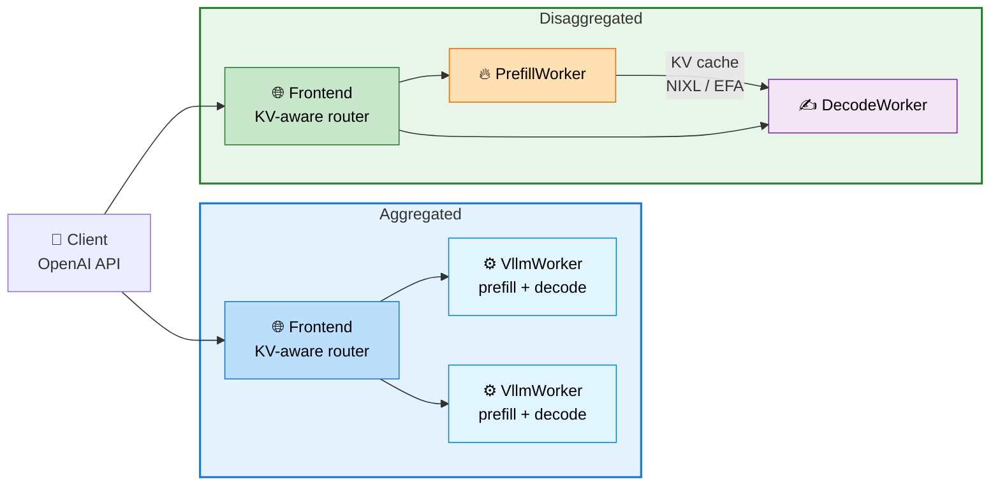
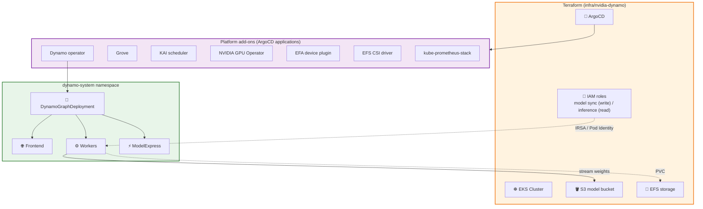
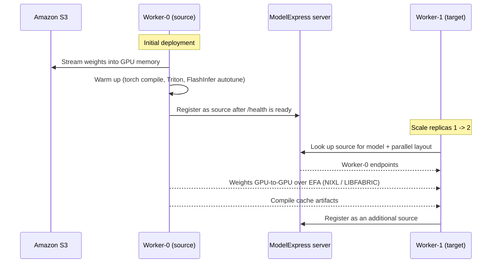

:::warning
Deployment of ML models on EKS requires access to GPUs or Neuron instances. If your deployment isn't working, it’s often due to missing access to these resources. Also, some deployment patterns rely on Karpenter autoscaling and static node groups; if nodes aren't initializing, check the logs for Karpenter or Node groups to resolve the issue.
:::

import Tabs from '@theme/Tabs';
import TabItem from '@theme/TabItem';
import CodeBlock from '@theme/CodeBlock';
import Admonition from '@theme/Admonition';
import StatusGrid from '@site/src/components/StatusGrid';
import SectionDivider from '@site/src/components/SectionDivider';
import ProgressSteps from '@site/src/components/ProgressSteps';

# NVIDIA Dynamo on Amazon EKS

<details>
<summary><strong>🚀 TL;DR – Serve LLMs with NVIDIA Dynamo on EKS</strong></summary>

**[NVIDIA Dynamo](https://github.com/ai-dynamo/dynamo) is an open-source inference stack that sits above inference engines such as vLLM.** It adds an OpenAI-compatible frontend, KV-aware routing, and disaggregated prefill/decode serving on top of the engine. This blueprint deploys the full Dynamo platform on Amazon EKS and ships ready-to-run model recipes.

### What You Get

- **☸️ A complete platform** – EKS cluster, Dynamo operator, Grove, KAI scheduler, NVIDIA GPU Operator, EFA device plugin, EFS CSI driver, and Prometheus, all delivered as ArgoCD applications
- **📦 Model weight caching** – Sync weights once from HuggingFace to Amazon S3 or to a shared EFS PVC, so replicas never download from HuggingFace at startup
- **⚡ Fast scale-out with ModelExpress** – New replicas copy weights and compile caches GPU-to-GPU over EFA from a running worker instead of reloading from S3
- **🔀 Aggregated and disaggregated serving** – Run prefill and decode in one worker, or split them across nodes with the KV cache moved over NIXL/EFA
- **🧾 Model recipes** – Tested `DynamoGraphDeployment` manifests per model and instance type

The workflow has three phases:

1. **Deploy infrastructure** – provision the EKS cluster and platform add-ons with Terraform.
2. **Prepare the environment** – configure `kubectl`, wait for the platform to converge, and create the ServiceAccounts, secrets, and storage the recipes depend on.
3. **Run a recipe** – sync a model's weights and deploy it.

**Key Implementation Details:**

<StatusGrid badges={[
  {
    type: 'production',
    icon: '☸️',
    title: 'EKS Control Plane',
    value: 'v1.36',
    note: 'Default, overridable in tfvars'
  },
  {
    type: 'info',
    icon: '🌎',
    title: 'Default Region',
    value: 'us-west-2',
    note: 'Set via tfvars or AWS_REGION'
  },
  {
    type: 'production',
    icon: '🧩',
    title: 'Namespace',
    value: 'dynamo-system',
    note: 'Platform and recipes'
  },
  {
    type: 'production',
    icon: '🔁',
    title: 'Add-on Delivery',
    value: 'ArgoCD',
    note: 'GitOps-managed platform'
  },
  {
    type: 'production',
    icon: '🖥️',
    title: 'GPU Provisioning',
    value: 'Karpenter',
    note: 'Capacity Block aware'
  },
  {
    type: 'production',
    icon: '🔗',
    title: 'Interconnect',
    value: 'EFA + NIXL',
    note: 'KV cache and P2P weights'
  },
  {
    type: 'info',
    icon: '🪣',
    title: 'Weight Storage',
    value: 'S3 or EFS',
    note: 'S3 recommended'
  },
  {
    type: 'warning',
    icon: '⏱️',
    title: 'First Deploy',
    value: '20-30 min',
    note: 'Cluster and node groups'
  }
]} />

</details>

<details>
<summary><strong>🖥️ Click to expand: GPU capacity requirements</strong></summary>

We recommend using [EC2 Capacity Blocks](https://docs.aws.amazon.com/AWSEC2/latest/UserGuide/ec2-capacity-blocks.html) to guarantee GPU availability (for example `p5.48xlarge` or `p6-b300.48xlarge`) for your deployment window.

<Admonition type="tip" title="Tag your Capacity Block with ai-on-eks=true">

When purchasing a Capacity Block, **tag the reservation with `ai-on-eks=true`**. Karpenter's GPU NodePool is configured to discover Capacity Blocks with this tag and launch instances into them, so your reserved capacity is used automatically when pods are scheduled.

</Admonition>

</details>

<SectionDivider icon="🧠" />

## What is NVIDIA Dynamo?

[NVIDIA Dynamo](https://github.com/ai-dynamo/dynamo) is an open-source, datacenter-scale inference serving framework for large language models. It doesn't replace the inference engine. It orchestrates engines such as vLLM, SGLang, and TensorRT-LLM, and adds the serving features that matter once a model spans multiple GPUs and nodes.

A Dynamo deployment is described by a single `DynamoGraphDeployment` custom resource. The Dynamo operator turns it into the pods, services, and gang-scheduled groups that make up the serving graph.

### Core Building Blocks

| Component | Role |
| --- | --- |
| **Frontend** | OpenAI-compatible HTTP endpoint. Routes requests across workers with KV-aware routing, so requests land where their prefix is already cached. |
| **Worker** | The inference engine (for example `VllmWorker`). In aggregated mode one worker does both prefill and decode. |
| **PrefillWorker / DecodeWorker** | In disaggregated mode, prefill and decode run as separate workers, each sized for its phase. |
| **NIXL** | NVIDIA's transfer library. Moves the KV cache from prefill to decode, and model weights between workers, over EFA using the `LIBFABRIC` backend. |
| **ModelExpress** | Optional. Tracks which workers hold a loaded model so new workers can copy weights and compile caches peer-to-peer. |

### Aggregated vs Disaggregated Serving

- **Aggregated** – each worker runs the full request: prefill (processing the prompt) and decode (generating tokens). Simple to operate and a good default.
- **Disaggregated** – prefill and decode run on separate workers. Prefill is compute-bound and decode is memory-bandwidth-bound, so splitting them lets you size and scale each phase independently. The KV cache produced by prefill moves to decode over NIXL/EFA, so both workers must land in the same zone.



<SectionDivider icon="🏗️" />

## Architecture on Amazon EKS

The blueprint provisions the cluster with Terraform and delivers every platform add-on as an ArgoCD application. Model weights live in Amazon S3 or on a shared EFS volume, and inference pods reach S3 through a ServiceAccount mapped to an IAM role.



<SectionDivider icon="🚀" />

## Deploying the Solution

:::info Deployment steps are collapsed
The full step-by-step deployment guide is inside the expandable section below. **Click it to open** the prerequisites, the install steps, and the environment preparation.
:::

<details>
<summary><strong>▶️ Click to expand: step-by-step deployment instructions</strong> (provision an Amazon EKS cluster with the NVIDIA Dynamo platform and prepare it for model recipes)</summary>

<ProgressSteps
  steps={[
    { title: "Prerequisites", description: "Install required tools" },
    { title: "Deploy", description: "Provision EKS and the Dynamo platform" },
    { title: "Prepare", description: "Configure access, secrets, and storage" }
  ]}
  currentStep={0}
/>

### Prerequisites

Ensure that you have installed the following tools on your machine:

- **[AWS CLI](https://aws.amazon.com/cli/)** - AWS Command Line Interface
- **[kubectl](https://kubernetes.io/docs/tasks/tools/)** - Kubernetes command-line tool
- **[terraform](https://developer.hashicorp.com/terraform/install)** - Infrastructure as Code tool
- **[helm](https://helm.sh/docs/intro/install/)** - used to run the model sync jobs
- **[jq](https://jqlang.github.io/jq/)** and **envsubst** (from `gettext`) - used to read Terraform outputs and render manifests
- A **[HuggingFace token](https://huggingface.co/settings/tokens)** - required for gated models and higher rate limits

### Deploy

#### 1. Clone the repository

```bash title="Clone the repository"
git clone https://github.com/awslabs/ai-on-eks.git
cd ai-on-eks/blueprints/inference/nvidia-dynamo
```

:::info Working Directory
All commands below run from `blueprints/inference/nvidia-dynamo`. Paths to the Terraform stack (`../../../infra/nvidia-dynamo`) are resolved from there. Recipe commands are the exception: they run from each recipe's own folder.
:::

:::info Authentication Profile
If you are using a profile for authentication, set `export AWS_PROFILE="<PROFILE_name>"` to the desired profile name.
:::

#### 2. Review and customize the configuration

Switch into the Terraform stack:

```bash
pushd ../../../infra/nvidia-dynamo
```

Edit [`terraform/blueprint.tfvars`](https://github.com/awslabs/ai-on-eks/blob/main/infra/nvidia-dynamo/terraform/blueprint.tfvars) to match your environment. The most common changes are the AWS region and the EKS control plane version. The Dynamo-specific add-ons are already enabled:

```hcl title="blueprint.tfvars" showLineNumbers
name                             = "dynamo-on-eks"
enable_dynamo_platform           = true
enable_kai_scheduler             = true
enable_grove                     = true
enable_aws_efs_csi_driver        = true
enable_aws_efa_k8s_device_plugin = true
enable_nvidia_gpu_operator       = true
enable_s3_models_storage         = true
# region                         = "us-west-2"
# eks_cluster_version            = "1.36"  # Uncomment to override default
```

You can control the deployment region in either of these ways:

- Edit `blueprint.tfvars` and set the `region` variable.
- Set the `AWS_REGION=<AWS_REGION>` environment variable.

> Default AWS region is `us-west-2`.

<ProgressSteps
  steps={[
    { title: "Prerequisites", description: "Install required tools" },
    { title: "Deploy", description: "Provision EKS and the Dynamo platform" },
    { title: "Prepare", description: "Configure access, secrets, and storage" }
  ]}
  currentStep={1}
/>

#### 3. Run the installer

```bash title="Deploy the NVIDIA Dynamo platform"
./install.sh
```

The script copies the shared Terraform base into a local `_LOCAL` workspace, bootstraps the backend, and runs `terraform apply`. It creates:

- The Amazon EKS cluster and the `dynamo-system` namespace
- An S3 bucket for model weights
- IAM roles for model sync (write) and inference (read)
- EFS storage for shared caches
- ArgoCD applications that install the platform and its dependencies

This step can take 20-30 minutes on a first run while the cluster and node groups come up. Once the apply completes, return to the blueprint directory:

```bash
popd
```

<ProgressSteps
  steps={[
    { title: "Prerequisites", description: "Install required tools" },
    { title: "Deploy", description: "Provision EKS and the Dynamo platform" },
    { title: "Prepare", description: "Configure access, secrets, and storage" }
  ]}
  currentStep={2}
/>

### Prepare the Environment

**Step 1: Configure kubectl access**

The Terraform stack exposes a ready-made `aws eks update-kubeconfig` command as the `configure_kubectl` output:

```bash
eval $(terraform -chdir="../../../infra/nvidia-dynamo/terraform/_LOCAL" output -raw configure_kubectl)
```

**Step 2: Wait for the ArgoCD applications to be healthy**

The platform add-ons (CSI drivers, GPU Operator, Dynamo operator, KAI scheduler, Grove, and so on) are ArgoCD applications. Wait for every application to report `Healthy` before continuing. Otherwise later steps can fail because a dependency, such as the EFS CSI driver or the Dynamo CRDs, isn't ready yet. This waits up to 10 minutes:

```bash
kubectl wait --for=jsonpath='{.status.health.status}'=Healthy \
  applications.argoproj.io --all \
  -n argocd \
  --timeout=600s
```

**Step 3: Set environment variables**

Read the S3 bucket name and the two ServiceAccount names from the Terraform outputs. The recipes reference `$S3_BUCKET`, `$MODEL_SYNC_SA`, and `$INFERENCE_SA` directly, so export them in the shell you'll run the recipes from:

```bash
eval "$(
  terraform -chdir="../../../infra/nvidia-dynamo/terraform/_LOCAL" output -json | jq -r '
    "export S3_BUCKET=" + (.s3_models_buckets_name.value[0]),
    "export MODEL_SYNC_SA=" + (.s3_models_sync_sa.value),
    "export INFERENCE_SA=" + (.s3_models_inference_sa.value)
  '
)"
```

| Variable | Purpose |
| --- | --- |
| `S3_BUCKET` | The bucket where model weights are stored. |
| `MODEL_SYNC_SA` | ServiceAccount used by the sync Job to **write** weights to S3. |
| `INFERENCE_SA` | ServiceAccount used by inference pods to **read** weights from S3. |

**Step 4: Create the ServiceAccounts**

Terraform maps each name to an IAM role (via IRSA or EKS Pod Identity): the sync SA gets write access to the bucket and the inference SA gets read access. Keeping them separate holds a least-privilege boundary between syncing and serving.

```bash
kubectl -n dynamo-system create sa $MODEL_SYNC_SA
kubectl -n dynamo-system create sa $INFERENCE_SA
```

**Step 5: Create the HuggingFace token secret**

The download and sync Jobs read this secret to authenticate with HuggingFace:

```bash
export HF_TOKEN=<HF TOKEN>
kubectl -n dynamo-system create secret generic hf-token-secret \
  --from-literal=HF_TOKEN=${HF_TOKEN}
```

**Step 6: Create the EFS PersistentVolumeClaims**

Create the shared EFS-backed caches. All three use the `efs-sc-dynamic` storage class with `ReadWriteMany` access so they can be shared across pods:

| PVC | Purpose |
| --- | --- |
| `model-cache` | Model weights for the PVC-based caching workflow. |
| `compilation-cache` | Compiled kernels and engines, so replicas don't recompile on every start. |
| `perf-cache` | Performance-tuning and benchmark artifacts. |

<details>
<summary>View <code>pvc-efs.yaml</code></summary>

<CodeBlock language="yaml" title="pvc-efs.yaml" showLineNumbers>
{require('!!raw-loader!@site/../blueprints/inference/nvidia-dynamo/pvc-efs.yaml').default}
</CodeBlock>

</details>

```bash
kubectl -n dynamo-system apply -f pvc-efs.yaml
```

**Step 7: Verify**

```bash
kubectl get applications.argoproj.io -n argocd
kubectl -n dynamo-system get sa,secret,pvc
```

**Expected output:** every ArgoCD application is `Synced` and `Healthy`, both ServiceAccounts and `hf-token-secret` exist, and the three PVCs are `Bound`.

</details>

<SectionDivider icon="⚡" />

## NVIDIA ModelExpress (Optional)

[ModelExpress](https://github.com/ai-dynamo/modelexpress) speeds up model distribution. It tracks model metadata and cache entries in-cluster and lets pods transfer weights peer-to-peer. Recipes with `mx` in the manifest name use it. Install its CRDs and RBAC once per cluster.

<Tabs groupId="modelexpress-setup">
<TabItem value="crds" label="1️⃣ CRDs" default>

Creates the `modelmetadatas.modelexpress.nvidia.com` and `modelcacheentries.modelexpress.nvidia.com` CRDs:

```bash
kubectl apply -f https://raw.githubusercontent.com/ai-dynamo/modelexpress/refs/heads/main/examples/crds.yaml
```

</TabItem>
<TabItem value="rbac" label="2️⃣ ServiceAccount and RBAC">

Creates the `modelexpress` ServiceAccount, `Role`, `RoleBinding`, and `ClusterRole`:

```bash
kubectl -n dynamo-system apply -f \
 https://raw.githubusercontent.com/ai-dynamo/modelexpress/refs/heads/main/examples/dynamo_p2p_transfer_k8s/vllm/rbac-modelmetadata.yaml
```

</TabItem>
</Tabs>

### How P2P Weight Transfer Works

The first worker does a cold start: it streams weights from S3 into GPU memory, runs the full warm-up (torch compile, Triton kernels, FlashInfer autotuning), and only registers as a **source** once its health endpoint reports ready. When you scale out, new workers find that source through the ModelExpress server and copy weights GPU-to-GPU over EFA, plus the compile caches, so they skip most of the warm-up.



:::note
A target only pairs with a source that serves the same model with the same parallel layout, and each GPU rank copies from the matching rank. Workers use a required `podAffinity` on zone so the RDMA transfer stays on the EFA fabric.
:::

<SectionDivider icon="📦" />

## Model Weight Caching

Recipes never download weights from HuggingFace at serving time. You sync them once to one of two targets, and the recipe manifest you choose decides which one it reads from.

<Tabs groupId="model-cache">
<TabItem value="s3" label="🪣 Amazon S3 (recommended)" default>

Syncs the model repository to your S3 bucket with the [AI on EKS inference-charts](https://github.com/awslabs/ai-on-eks-charts/tree/main/charts/inference-charts) Helm chart. The chart's `s3ModelCopy` component runs a one-shot Job on an NVMe-equipped, high-bandwidth node and downloads files in parallel. Weights land under `s3://$S3_BUCKET/$MODEL_NAME/`.

**Best for:** durable storage shared across clusters, regions, or accounts, and the most cost-effective option.

```bash
helm repo add ai-on-eks https://awslabs.github.io/ai-on-eks-charts/
helm repo update
```

```bash title="Sync a model to S3"
export MODEL_NAME=<MODEL NAME>   # e.g. Qwen/Qwen3-32B
helm -n dynamo-system install hf-s3-sync-model ai-on-eks/inference-charts -f - <<EOF
s3ModelCopy:
  namespace: dynamo-system
  model: $MODEL_NAME
  s3Bucket: $S3_BUCKET
  hfTokenSecret:
    name: "hf-token-secret"
    envFrom: true
  serviceAccountName: $MODEL_SYNC_SA
  requireLocalNvme: true
  storageSize: 100
  requireNetworkBandwidth: 25000
  parameters:
    fileWorkers: 18
EOF
```

| Value | Meaning |
| --- | --- |
| `serviceAccountName` | The sync ServiceAccount, mapped to an IAM role with write access to the bucket. |
| `requireLocalNvme` / `requireNetworkBandwidth` | Place the Job on an NVMe-backed node with at least 25 Gbps of network bandwidth. |
| `parameters.fileWorkers` | Files downloaded in parallel. |
| `storageSize` | Scratch volume in GiB. Size it as roughly the largest file in the repo times `fileWorkers`. |

Each recipe lists tuned values for its model.

**Monitor and clean up:**

```bash
kubectl -n dynamo-system wait --for=condition=ready pod \
  -l app.kubernetes.io/name=s3-model-copy,app.kubernetes.io/instance=hf-s3-sync-model --timeout=600s
kubectl -n dynamo-system logs -f \
  -l app.kubernetes.io/name=s3-model-copy,app.kubernetes.io/instance=hf-s3-sync-model
kubectl -n dynamo-system get job -l app.kubernetes.io/instance=hf-s3-sync-model
aws s3 ls "s3://$S3_BUCKET/$MODEL_NAME/" --recursive --human-readable --summarize

helm -n dynamo-system uninstall hf-s3-sync-model
```

:::caution Pod stuck in Pending?
Karpenter may not find a node that satisfies the NVMe and bandwidth constraints, because of regional instance availability, EC2 vCPU quota, or NodePool requirements that exclude matching instances. Check the pod's `FailedScheduling` events and the Karpenter controller logs. If no matching instances are available to you, lower `requireNetworkBandwidth` first, then `storageSize` and `fileWorkers`.
:::

</TabItem>
<TabItem value="pvc" label="📁 EFS PVC">

Runs a Job that pulls the model repository from HuggingFace into the shared `model-cache` PVC, with `HF_HUB_ENABLE_HF_TRANSFER=1` and `HF_XET_HIGH_PERFORMANCE=1` for faster downloads.

**Best for:** the simplest consumption path. Weights appear as a shared filesystem path with no S3 client or IAM setup. The tradeoff is throughput: shared EFS storage is easy to mount `ReadWriteMany` but can load models more slowly than S3 streaming.

<details>
<summary>View <code>model-download.yaml</code></summary>

<CodeBlock language="yaml" title="model-cache/model-download.yaml" showLineNumbers>
{require('!!raw-loader!@site/../blueprints/inference/nvidia-dynamo/model-cache/model-download.yaml').default}
</CodeBlock>

</details>

```bash title="Sync a model to the model-cache PVC"
export MODEL_NAME=<MODEL NAME>   # e.g. Qwen/Qwen3-32B
envsubst '${MODEL_NAME}' < model-cache/model-download.yaml | kubectl apply -n dynamo-system -f -
```

**Monitor and clean up:**

```bash
kubectl -n dynamo-system wait --for=condition=ready pod --selector=job-name=model-download --timeout=600s
kubectl -n dynamo-system logs -l app=model-download -f
kubectl -n dynamo-system get job/model-download

kubectl -n dynamo-system delete job/model-download   # weights stay on the PVC
```

</TabItem>
</Tabs>

<SectionDivider icon="🧾" />

## Deploy a Model

Each model lives under [`recipes/`](https://github.com/awslabs/ai-on-eks/tree/main/blueprints/inference/nvidia-dynamo/recipes). A recipe README documents the model-specific sync values, the manifests it ships, and how to test it. Recipe commands use paths relative to the recipe folder, so switch into it first:

```bash
pushd recipes/<recipe>
# ...run the recipe commands...
popd
```

### Available Recipes

| Recipe | Model | Instance | Engine |
| --- | --- | --- | --- |
| [qwen3-32b](https://github.com/awslabs/ai-on-eks/tree/main/blueprints/inference/nvidia-dynamo/recipes/qwen3-32b) | [Qwen/Qwen3-32B](https://huggingface.co/Qwen/Qwen3-32B) | `p5.48xlarge` (H100) | vLLM |
| [glm-5.3](https://github.com/awslabs/ai-on-eks/tree/main/blueprints/inference/nvidia-dynamo/recipes/glm-5.3) | [zai-org/GLM-5.3](https://huggingface.co/zai-org/GLM-5.3) | `p6-b300.48xlarge` (B300) | vLLM |
| [glm-5.3-flash](https://github.com/awslabs/ai-on-eks/tree/main/blueprints/inference/nvidia-dynamo/recipes/glm-5.3-flash) | [zai-org/GLM-5.3-Flash](https://huggingface.co/zai-org/GLM-5.3-Flash) | `g7e.48xlarge` | vLLM |
| [nemotron-3-ultra](https://github.com/awslabs/ai-on-eks/tree/main/blueprints/inference/nvidia-dynamo/recipes/nemotron-3-ultra) | [nvidia/NVIDIA-Nemotron-3-Ultra-550B-A55B-BF16](https://huggingface.co/nvidia/NVIDIA-Nemotron-3-Ultra-550B-A55B-BF16) | `p6-b300.48xlarge` (B300) | vLLM |
| [nemotron-3.5-bolt-e4b](https://github.com/awslabs/ai-on-eks/tree/main/blueprints/inference/nvidia-dynamo/recipes/nemotron-3.5-bolt-e4b) | [nvidia/NVIDIA-Nemotron-3.5-Bolt-E4B-BF16](https://huggingface.co/nvidia/NVIDIA-Nemotron-3.5-Bolt-E4B-BF16) | `g6e` | vLLM |

Manifest names encode the instance, topology, and weight source. For example `h100-agg-mx-s3.yaml` is aggregated serving on H100 that loads weights from S3 through ModelExpress, and `h100-disagg.yaml` is disaggregated prefill/decode from the `model-cache` PVC.

### Walkthrough: Qwen3-32B

This example deploys Qwen3-32B with TP=4 on a `p5.48xlarge`, loading weights from S3 through ModelExpress. It assumes you [synced the weights to S3](#model-weight-caching) with `MODEL_NAME="Qwen/Qwen3-32B"` and installed [ModelExpress](#nvidia-modelexpress-optional).

<Tabs groupId="qwen3-walkthrough">
<TabItem value="deploy" label="1️⃣ Deploy" default>

```bash title="Deploy Qwen3-32B (aggregated, S3 + ModelExpress)"
cd recipes/qwen3-32b
envsubst '${S3_BUCKET} ${INFERENCE_SA}' < vllm/h100-agg-mx-s3.yaml | kubectl apply -n dynamo-system -f -

kubectl -n dynamo-system logs \
  -l nvidia.com/dynamo-graph-deployment-name=qwen3-32b-h100-agg-mx-s3-vllm \
  --all-containers=true --max-log-requests=20 --prefix=true --timestamps -f
```

The deployment starts three components: `Frontend`, `ModelExpress` (with Kubernetes as its metadata backend, so no Redis is needed), and `VllmWorker`.

</TabItem>
<TabItem value="manifest" label="📄 Manifest">

<CodeBlock language="yaml" title="recipes/qwen3-32b/vllm/h100-agg-mx-s3.yaml" showLineNumbers>
{require('!!raw-loader!@site/../blueprints/inference/nvidia-dynamo/recipes/qwen3-32b/vllm/h100-agg-mx-s3.yaml').default}
</CodeBlock>

</TabItem>
<TabItem value="test" label="2️⃣ Smoke Test">

Wait for the workers to become ready, then port-forward the frontend:

```bash
export GRAPH=qwen3-32b-h100-agg-mx-s3-vllm

kubectl -n dynamo-system wait pod \
  -l nvidia.com/dynamo-graph-deployment-name=${GRAPH} \
  --for=condition=Ready --timeout=30m

kubectl -n dynamo-system port-forward svc/${GRAPH}-frontend 8000:8000
```

In a second terminal:

```bash
curl -s localhost:8000/v1/models | jq

curl -s localhost:8000/v1/chat/completions \
  -H "Content-Type: application/json" \
  -d '{
    "model": "Qwen/Qwen3-32B",
    "messages": [
      {"role": "user", "content": "Explain what Kubernetes is in two sentences."}
    ],
    "max_tokens": 1024,
    "stream": false
  }' | jq
```

A successful response returns the answer in `choices[0].message.content`. Qwen3 thinks by default and these manifests don't set a reasoning parser, so the `<think>` block appears inside `content`.

</TabItem>
<TabItem value="scale" label="3️⃣ Scale Out">

Scale `VllmWorker` (index `2` in `spec.components`) from 1 to 2 replicas. The `test` op makes the patch fail if that index points to a different component:

```bash
kubectl patch dynamographdeployment qwen3-32b-h100-agg-mx-s3-vllm \
  -n dynamo-system \
  --type='json' \
  -p='[
    {"op": "test", "path": "/spec/components/2/name", "value": "VllmWorker"},
    {"op": "replace", "path": "/spec/components/2/replicas", "value": 2}
  ]'
```

The new worker copies weights and compile caches from the first one over EFA instead of streaming from S3. Compare the time from container start to Ready:

```bash
kubectl -n dynamo-system get pods \
  -l nvidia.com/dynamo-graph-deployment-name=qwen3-32b-h100-agg-mx-s3-vllm,nvidia.com/dynamo-component=VllmWorker \
  -o custom-columns='POD:.metadata.name,STARTED:.status.startTime,READY:.status.conditions[?(@.type=="Ready")].lastTransitionTime'
```

Once both are Ready, the Frontend routes across them with KV-aware routing, so the smoke test works unchanged.

</TabItem>
<TabItem value="remove" label="🧹 Remove">

```bash
envsubst '${S3_BUCKET} ${INFERENCE_SA}' < vllm/h100-agg-mx-s3.yaml | kubectl delete -n dynamo-system -f -
```

</TabItem>
</Tabs>

For the PVC-based aggregated and disaggregated variants, see the [Qwen3-32B recipe README](https://github.com/awslabs/ai-on-eks/tree/main/blueprints/inference/nvidia-dynamo/recipes/qwen3-32b).

---

## Cleanup

<Tabs groupId="cleanup-steps">
<TabItem value="workloads" label="1️⃣ Remove Model Deployments" default>

Delete each recipe you deployed using the cleanup commands in its README. For example:

```bash
pushd recipes/qwen3-32b
envsubst '${S3_BUCKET} ${INFERENCE_SA}' < vllm/h100-agg-mx-s3.yaml | kubectl delete -n dynamo-system -f -
popd
```

</TabItem>
<TabItem value="infra" label="2️⃣ Destroy Infrastructure">

:::warning
This destroys every Terraform-managed resource created by `install.sh`, **including the S3 bucket and its model weights**. Back up anything you want to keep first.
:::

Run from `blueprints/inference/nvidia-dynamo`:

```bash
pushd ../../../infra/nvidia-dynamo
./cleanup.sh
popd
```

</TabItem>
</Tabs>
