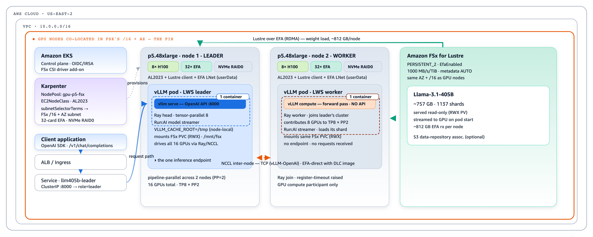

# Multi-node inference using FSx for Lustre over EFA to reduce cold start for large models

Large models spend most of their cold start reading weights from storage. This blueprint shows how to
cut that time by loading weights from **Amazon FSx for Lustre over EFA (RDMA)** for a **multi-node**
serving stack on Amazon EKS. EFA removes the single-flow TCP ceiling on the storage read — the dominant
cost of cold-starting a very large model — so parallel reads scale and the model is ready sooner (see
[Accelerating model loading with FSx for Lustre over EFA](../../../../guidance/container-startup-time/3-accelerate-model-load-over-efa.md)).

The **example workload** is **Llama-3.1-405B across two p5.48xlarge nodes (16 GPUs, TP8 × PP2)** — a
model too large for a single 8-GPU node, so it is split across two nodes with **LeaderWorkerSet + Ray**
(tensor-parallel within a node over NVLink, pipeline-parallel across nodes), with weights streamed from
FSx over EFA via the Run:AI Model Streamer. The pattern applies to any large multi-node model.

## Architecture



## Two image variants

| Variant | Base image | Inter-node NCCL | Use when |
|---|---|---|---|
| **vLLM-OpenAI** | `vllm/vllm-openai` | TCP | the simplest public image |
| **DLC** | AWS Deep Learning Container | **EFA** (aws-ofi-nccl) | you also want NCCL-over-EFA for GPU-to-GPU traffic |

FSx weight loading rides EFA in **both** variants (a node/network property); they differ only in the
inter-node GPU (NCCL) transport.

## Prerequisites

1. **Base deployed with the FSx-EFA options on** — use the blueprint's infra wrapper
   (`infra/vllm-llama3.1-405b-lws-gpu-fsx/`), whose `blueprint.tfvars` enables `deploy_fsx_volume`,
   `fsx_efa_enabled`, the FSx CSI driver, the EFA device plugin, and an EFA GPU node pool. The
   networking requirement (same AZ + same /16 CIDR) and setup are in the
   [FSx for Lustre over EFA guide](../../../../guidance/fsx-lustre-efa-on-eks.md).
2. **Model weights staged on FSx** at `/mnt/fsx/models/Llama-3.1-405B-Instruct`.
3. **A custom image** built and pushed to your ECR (base vLLM image + Ray + Run:AI streamer).
4. **LeaderWorkerSet controller** installed (the Terraform deploy path installs it for you).

## Deploy

Clone the repo, then follow the step-by-step instructions (including the image build) in each variant's
`README.md`:

```bash
git clone https://github.com/awslabs/ai-on-eks.git

# vLLM-OpenAI variant — inter-node NCCL over TCP
cd ai-on-eks/blueprints/inference/vllm-llama3.1-405b-lws-gpu-fsx

# DLC variant — inter-node NCCL over EFA
cd ai-on-eks/blueprints/inference/vllm-llama3.1-405b-lws-gpu-fsx-dlc
```

Each variant ships a plain Kubernetes manifest (**kubectl** path) and an equivalent **Terraform** path.
At a glance:

```bash
# kubectl path (after installing LWS + replacing <YOUR_ECR_IMAGE> in the manifest)
kubectl apply -f vllm-405b-lws-gpu-fsx.yaml

# Terraform path
cd terraform && terraform init && terraform apply \
  -var region=<region> -var cluster_name=<cluster> -var vllm_image=<your-ecr-image>
```

## Verify

```bash
kubectl get pods -l app=vllm-405b          # leader + worker Running; leader Ready after weight load
kubectl exec <leader-pod> -- \
  curl -s http://llm405b-leader.default.svc.cluster.local:8000/v1/models
```

First readiness takes several minutes (weight load + CUDA-graph capture).

## Learn more

- [FSx for Lustre over EFA on EKS](../../../../guidance/fsx-lustre-efa-on-eks.md) — the networking requirement, enabling EFA on FSx, node placement, and validation.
- [Accelerating model loading with FSx for Lustre over EFA](../../../../guidance/container-startup-time/3-accelerate-model-load-over-efa.md) — the cold-start rationale.

## Important notes

:::warning
Deployment of ML models on EKS requires access to GPUs. This blueprint uses **2× p5.48xlarge
(16 GPUs)** — ensure you have the capacity (on-demand, an ODCR, or a Capacity Block) before
deploying. If nodes aren't initializing, check the Karpenter or node-group logs.
:::

:::caution
[meta-llama/Llama-3.1-405B-Instruct](https://huggingface.co/meta-llama/Llama-3.1-405B-Instruct)
is a gated model — you must accept its license on Hugging Face and stage the weights on the FSx
filesystem before deploying.
:::
