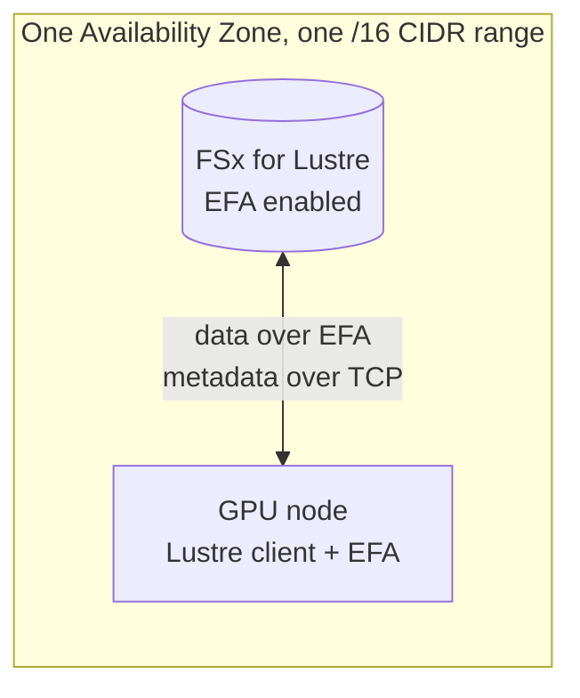

# Accelerating model loading with FSx for Lustre over EFA

The previous pages address the *image* half of cold start. Once large model artifacts are
[decoupled from the image](./1-reduce-container-image-size/14-decoupling-model-artifacts.md) and placed on shared
storage, a second cost appears: reading those weights into GPU memory when a pod starts. For models with hundreds
of GB of weights this read can dominate cold start and leave GPUs idle while it completes.

[Amazon FSx for Lustre](https://docs.aws.amazon.com/fsx/latest/LustreGuide/what-is.html) supports
[Elastic Fabric Adapter (EFA)](https://docs.aws.amazon.com/fsx/latest/LustreGuide/efa-file-systems.html), which AWS
recommends for file systems that need more than 10 GBps of throughput. EFA uses an OS-bypass network path and the
Scalable Reliable Datagram (SRD) protocol to raise throughput per client instance.

## Is FSx for Lustre the right tool for your model loading?

Decide this first. An EFA-enabled FSx for Lustre file system has properties that make it a poor fit for some
workloads:

- **Single Availability Zone.** The file system and every EFA client must be in the same AZ. A deployment that must
  scale across AZs needs one file system per AZ, or a different mechanism.
- **Provisioned capacity and throughput.** You pay for the provisioned storage and throughput tier whether or not
  weights are being read. If a file system exists only to serve model weights at pod start, compare its cost with the
  time-to-ready it saves.
- **Create-time decisions.** EFA cannot be enabled or disabled on an existing file system, and the throughput tier of
  an EFA-enabled file system cannot be changed.
- **Not every cold start is storage-bound.** After the read, weights still move to the GPUs and are distributed
  across them, and engines may compile or warm up. Measure where your own cold start spends time before
  choosing a solution.

Compare against other approaches for your model size and scale-out pattern, for example streaming weights directly
from Amazon S3 into the inference engine, or sharing weights between workers over RDMA (see the ModelExpress usage in
the [NVIDIA Dynamo blueprint](../../blueprints/inference/framework-guides/GPUs/nvidia-dynamo.md)). FSx for Lustre
over EFA is a good fit when several workloads already share a Lustre file system, or when you need a POSIX file system
with high throughput per client in one AZ.

## Requirements

These come from the Amazon FSx for Lustre documentation on
[EFA-enabled file systems](https://docs.aws.amazon.com/fsx/latest/LustreGuide/efa-file-systems.html),
[EFA-enabled security groups](https://docs.aws.amazon.com/fsx/latest/LustreGuide/limit-access-security-groups.html#efa-security-groups)
and [configuring EFA clients](https://docs.aws.amazon.com/fsx/latest/LustreGuide/configure-efa-clients.html).
Check them for current values before you deploy.

**File system**

- Deployment type `PERSISTENT_2` with a metadata configuration.
- A region that supports EFA-enabled `PERSISTENT_2` file systems. See
  [Deployment type availability](https://docs.aws.amazon.com/fsx/latest/LustreGuide/using-fsx-lustre.html#persistent-deployment-regions).
  Availability can differ by throughput tier, so choose the tier from that table for your region.

**Client nodes**

- Nitro v4 or later EC2 instances that support EFA, excluding the `trn2` family.
- Amazon Linux 2023, RHEL 9.5 or newer, or Ubuntu 22.04 or newer with kernel 6.8 or newer. Bottlerocket is not
  listed as supported.
- The Lustre client and the EFA driver installed, and the Lustre client configured for EFA. The Deep Learning AMI has
  these pre-installed. For other images, add them in the node bootstrap or the node image, and confirm what your
  AMI already includes. See [Prepare the nodes](#prepare-the-nodes) for what we found on the EKS-optimized AMI.

**Network placement**

- The client and the file system must be in the **same Availability Zone**.
- The client's subnet and the file system's subnet must be in the **same `/16` CIDR range**, which means their IPv4
  addresses share the same first two octets. The documentation example: a client in `10.24.34.0/24` can use EFA with
  a file system in `10.24.56.0/24`, but not with one in `10.25.34.0/24`.
- The two subnets do not have to be the same subnet, and neither has to be a `/16` subnet. The requirement is about
  the shared first two octets.

If the placement rule is not met, the mount can still succeed, because metadata traffic uses TCP. In one test on a
`c6i.32xlarge` with the file system in a different `/16` than the node (everything else identical to a working setup),
the mount succeeded, but the client's connection to the file system's storage server stayed in `CONNECTING` for about
six minutes. A job that takes 30 seconds in a correct setup took almost ten minutes, and the data then moved over TCP:
the EFA counters did not change. The EFA addresses that LNet showed carried only the last two octets of each IP
address, which is consistent with the first-two-octets rule, but we did not confirm that this is the cause. This is a
single run, so treat the timings as an illustration and not as a measurement.

**Security groups**

- The file system and client security groups must allow all traffic to and from each other, and the file system
  security group must allow all traffic to and from itself.
- Rules must reference **security group IDs**. CIDR-based rules, including `0.0.0.0/0`, do not satisfy the EFA
  requirement even when they allow all traffic.
- If the file system and the clients share one security group with self-referencing all-traffic rules, that single
  group satisfies both sides.
- On EKS, the default [cluster security group](https://docs.aws.amazon.com/eks/latest/userguide/sec-group-reqs.html)
  has all-traffic rules from itself and to itself, and the EKS documentation lists the outbound one as being for EFA
  traffic. Using it for both the nodes and the file system satisfies this requirement. Check that the outbound rule is
  present on your cluster: in our testing, clusters on Kubernetes 1.31 and 1.32 did not have it, and a smoke test on the
  file system stalled until it was added.

**Other limits**

- Metadata traffic between clients and the file system always uses TCP.
- One file system supports at most 8192 EFA connections across all client instances. Each configured EFA interface on
  a client counts as one connection.

## Architecture on EKS

On an AI on EKS cluster the Karpenter node pools use the secondary-CIDR private subnets. If the file system is created
in the secondary subnet of the same AZ as the GPU nodes, the AZ and `/16` requirements hold without pinning a node
pool to a specific subnet, and without creating one node pool per AZ.



Create the file system from Kubernetes with a `StorageClass` and a `PersistentVolumeClaim`, using the
[FSx CSI driver's dynamic provisioning](https://github.com/kubernetes-sigs/aws-fsx-csi-driver/tree/master/examples/kubernetes/efa),
instead of creating it in Terraform:

- A file system that cannot be created (for example, because FSx rejects the request for the chosen configuration)
  fails the PVC, not the cluster Terraform state.
- The AZ is chosen per workload by the `StorageClass` subnet, which keeps the cluster node pools generic.
- The file system lifecycle follows the PVC and the `StorageClass` `reclaimPolicy`.

```yaml
apiVersion: storage.k8s.io/v1
kind: StorageClass
metadata:
  name: fsx-lustre-efa
provisioner: fsx.csi.aws.com
parameters:
  subnetId: <subnet in the same AZ and /16 as the GPU nodes>
  securityGroupIds: <security group with all-traffic self-referencing rules>
  deploymentType: PERSISTENT_2
  perUnitStorageThroughput: "1000"        # choose from the availability table for your region
  metadataConfigurationMode: AUTOMATIC
  efaEnabled: "true"
  fileSystemTypeVersion: "2.15"
reclaimPolicy: Delete
volumeBindingMode: Immediate
---
apiVersion: v1
kind: PersistentVolumeClaim
metadata:
  name: fsx-lustre-efa
spec:
  accessModes: [ReadWriteMany]
  storageClassName: fsx-lustre-efa
  resources:
    requests:
      storage: 4800Gi                      # size for your data and throughput; see below
```

With `PERSISTENT_2` and EFA, storage per file server depends on the throughput tier (for example 4.8 TiB per server at
1000 MBps per TiB, according to the
[file system documentation](https://docs.aws.amazon.com/fsx/latest/LustreGuide/using-fsx-lustre.html)). Capacity
therefore affects both cost and how many servers your data and throughput are spread across.

A runnable reference that implements this pattern (node pools, security group, helper script) is in the
[`infra/fsx-lustre-efa`](https://github.com/awslabs/ai-on-eks/tree/main/infra/fsx-lustre-efa) blueprint.

## Prepare the nodes

The node must have the Lustre client with EFA support configured before a pod can mount the file system over EFA.

We checked what the EKS-optimized Amazon Linux 2023 AMI contains by launching a `c6i.32xlarge` node with no custom
bootstrap (Kubernetes 1.36, Amazon Linux 2023.12.20261118, kernel 6.18.62):

- **Already present:** the EFA driver (`efa` 3.3.1g, with the device visible), and the Lustre kernel modules
  (`lustre` 2.15.6 and `lnet`), including the EFA transport (`kefalnd` 1.2.6).
- **Not present:** the Lustre userspace tools (`lctl`, `lnetctl`, `lfs`, `mount.lustre`), and the LNet configuration
  that adds the EFA interface.

Without the missing pieces the file system still mounts and works, but only over TCP. In that test the mount
succeeded, LNet had only a `tcp` interface, the EFA counters stayed at zero, and the 64 GiB test read ran at about
590 MiB/s, against about 4,681 MiB/s over EFA in the same setup (single runs, so treat them as an illustration).

The minimum bootstrap that gave EFA was two steps: install the `lustre-client` package, then run the AWS
configuration script from [Configuring EFA clients](https://docs.aws.amazon.com/fsx/latest/LustreGuide/configure-efa-clients.html).
The `lustre-client` package came from the Amazon Linux 2023 repository. The AWS installation script's EFA option was
not needed on this AMI, because that script installs the EFA driver only when it is missing or older than its minimum
version. The configuration script is still a download at node boot. For a production fleet, bake both steps into your
node image so that node startup is reproducible and does not depend on a download at scale-out time.

We ran the two-step sequence on both AMI variants: the standard variant on a `c6i.32xlarge`, and the NVIDIA variant
(`amazon-eks-node-al2023-x86_64-nvidia-1.36-v20261119`) on a `p5.48xlarge` Spot node. On the P5 node the bootstrap
added only the `lustre-client` package, LNet came up with 8 EFA interfaces, and a 64 GiB test read moved exactly
64 GiB on the EFA hardware counters. Other AMI releases and operating systems can differ, so check yours.

:::note
With Karpenter, custom node bootstrap goes in the `EC2NodeClass` `userData`. If a step fails, the node can still
join the cluster without EFA, and the volume will still mount over TCP, so always run the verification below on the
nodes you create.
:::

## Verify that EFA is in use

A mount that succeeds is not proof that data moves over EFA. On the node:

```bash
# The EFA network should be listed with the EFA interfaces
sudo lnetctl net show

# EFA hardware counters, summed over the devices; rdma_read_bytes should increase while data is read
cat /sys/class/infiniband/<device>/ports/1/hw_counters/rdma_read_bytes

# State of the connections to the storage servers; they should be FULL with few connection attempts
sudo lctl get_param -n osc.*.import | grep -E "state:|connection_attempts"
```

If the counters stay flat while data is read, the data is not using EFA. If a connection stays in `CONNECTING` for a
long time, reads stall while the client retries. Check, in order: same AZ, same first two octets of the client and
file system subnets, security group rules that reference security group IDs, and that the Lustre client was configured
for EFA on that node.

## Tuning

Lustre spreads a file across object storage targets according to its stripe layout, so the layout of the model
directory affects read parallelism. Set the layout before writing the weights (`lfs setstripe`). Changing stripe
settings does not rewrite files that already exist, and scaling the file system capacity does not restripe existing
data. Measure with your own model files; the right stripe count depends on file sizes and reader concurrency.
