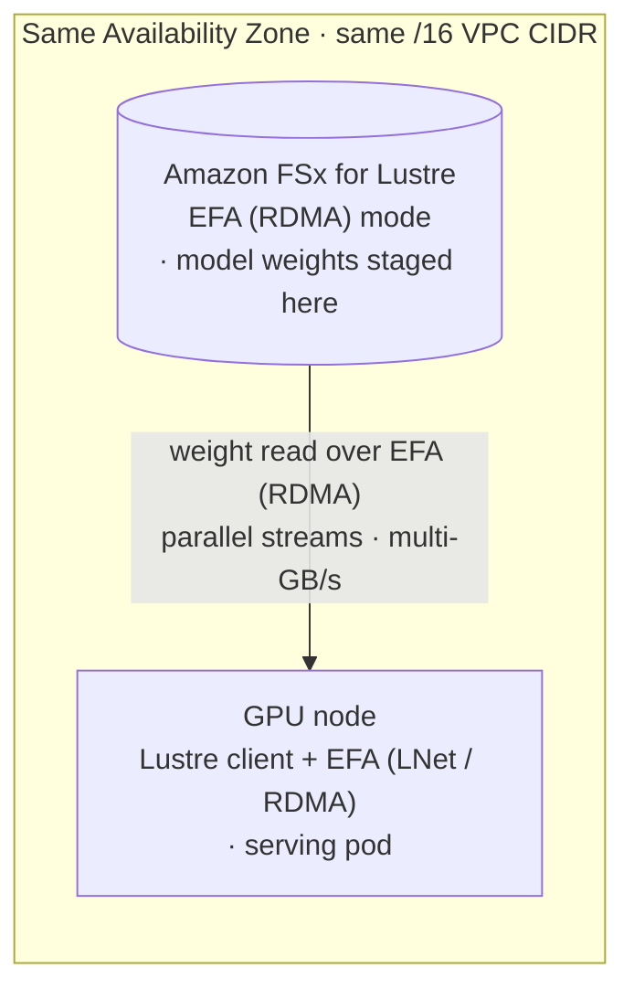

# Accelerating model loading with FSx for Lustre over EFA

**"Reducing container image size"** and **"Accelerating pull process"** (the previous two pages) address
the *image* half of cold start. But once large model artifacts are
[decoupled from the image](./1-reduce-container-image-size/14-decoupling-model-artifacts.md) onto shared
storage, a second cost appears: **reading those weights into GPU memory at pod start** — which, for very
large models (hundreds of GB), can dominate cold start and leave expensive GPUs idle while it completes.

**The lever:** host the weights on **Amazon FSx for Lustre** and read them over **EFA (RDMA)**. Over plain
TCP a single FSx-Lustre read is capped by the EC2 single-flow network limit (adding client threads doesn't
lift it); EFA removes that ceiling, so parallel reads scale to multiple GB/s and the read phase of cold
start shrinks. EFA is a node/network property, so any serving stack reading from the EFA-enabled FSx mount
benefits — no image or framework changes.

The setup, tuning, and trade-offs live in one place:

- **→ [FSx for Lustre over EFA on EKS](../fsx-lustre-efa-on-eks.md)** — the full guide: the same-AZ/+16
  requirement, enabling EFA on the base, placing GPU nodes, verifying EFA, stripe/OST tuning, and cost.
- **→ [Multi-node Llama-3.1-405B blueprint](../../blueprints/inference/framework-guides/GPUs/vllm-llama3.1-405b-lws-gpu-fsx.md)**
  — a complete, runnable example that loads a 405B-parameter model from FSx over EFA.

**When it helps most:** large models where the weight read dominates cold start. For small models, the
image-size and pull optimizations above matter more.
